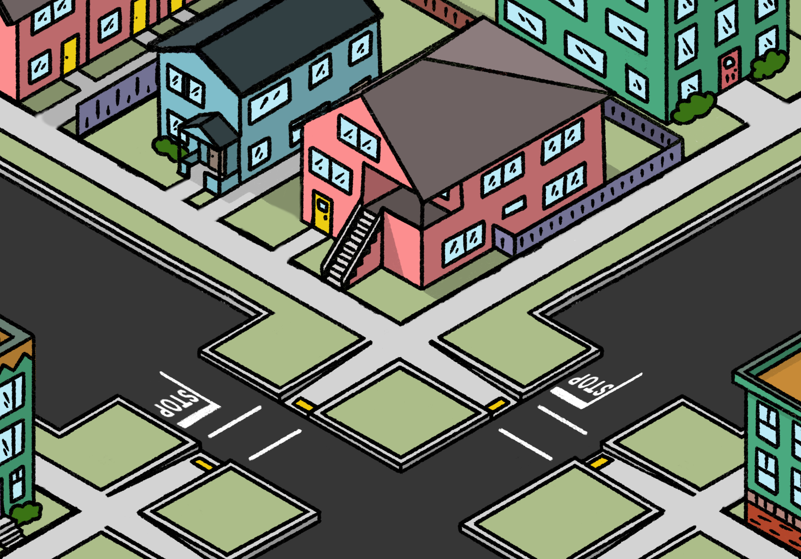

**!!!This is a work in progress draft and things may change!!!**
<!-- 
 -->

Two years ago the city of Sacramento approved the 2040 General Plan which proposed a new guideline for building density using Floor Area Ratio. 

Floor Area Ratio (FAR) is the ratio between the floor area of a building and the lot the building sits on. FAR is used by the city to designate how dense areas of the city can be. Midtown ranges from a FAR of 2-8 whereas Oak Park ranges from 2-4. The higher the FAR the more dense a place can be.

In older parts of Sacramento - including Oak Park - a 2800 square foot (sqft) lot, 40” by 70” is common, being about half of the 150ft from sidewalsk to ally. (As seen in [Image](#FAR%20Empty.jpg))

If a 2800sqft building is added to the lot the FAR would simply be 1. (As seen in [Image](#FAR%201.1.jpg))

Alternatively if a 1 story, 1400sqft building was built on the same 2800 sqft lot, the FAR would be 0.5 because the building fits only half the lot. (As seen in [Image](#FAR%200.5.1.jpg))

The floor area can also be spread between floors. A 1400sqft building with two 700sqft floors also has a FAR of 0.5. (As seen in [Image](#FAR%200.5.2.jpg)) 

In the real world, buildings are rarely built into the corners of lots. Zoning has setbacks that regulate how close a building can be placed to the edge of a lot. Taking this basic rectangle, centering it, and adding some features creates a realistic view of how a house with a FAR of 0.5 would look like in real life. (As seen in [Image](#FAR%200.5.3.jpg))   

## More Examples

Below are some examples of building shapes and homes with a FAR of 1 and up. 

### FAR 1

### FAR 2

## Learn more

To dive deeper into FAR and see what it looks like with real buildings check out [FAR in Real Life](../../articles/writing/far-in-real-life.html)

